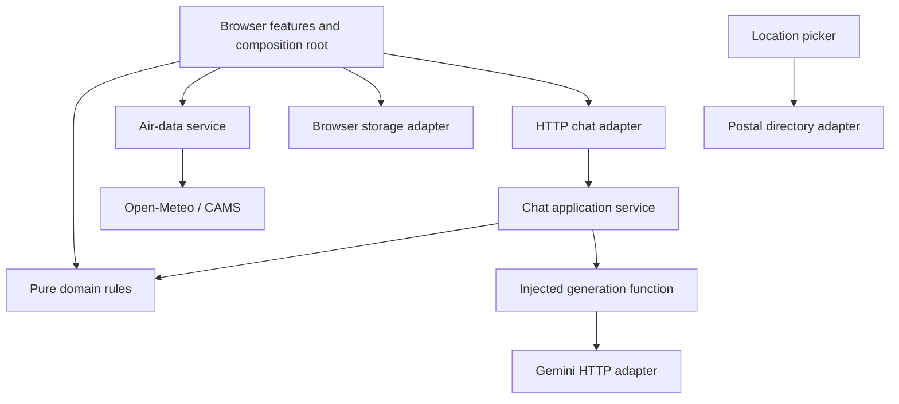

# Architecture and design decisions

Breathewell is a small modular application with a static browser client and a serverless API. It uses functional dependency injection and ports/adapters rather than an inheritance hierarchy. The same application service runs behind local Node HTTP and Vercel handlers.

## Dependency boundaries

| Responsibility                    | Location                                                      | Boundary                                              |
| --------------------------------- | ------------------------------------------------------------- | ----------------------------------------------------- |
| Indian AQI math and completeness  | `public/domain/air-quality.js`                                | Pure, no network or DOM                               |
| Personalization and explanations  | `public/domain/recommendations.js`                            | Pure profile-to-plan transformation                   |
| Carbon assumptions                | `public/domain/impact.js`                                     | One explicit baseline and input limits                |
| Profile normalization and privacy | `public/domain/profile.js`                                    | Allowlisted context, no coordinates sent to GenAI     |
| Urgent symptom routing            | `public/domain/safety.js`                                     | Shared by local and generated paths                   |
| Chat use case                     | `lib/application/chat-service.mjs`                            | Injected generation/configuration/logger ports        |
| HTTP concerns                     | `lib/chat.mjs`, `lib/http.mjs`                                | Methods, body size, status codes, origin, rate limits |
| Provider integration              | `lib/gemini.mjs`                                              | Authentication, deadlines, typed safe failures        |
| Browser network I/O               | `public/services/air-quality.js`                              | Abortable requests and provenance                     |
| Browser persistence               | `public/state/storage.js`                                     | Validated preferences and India-day completion        |
| Presentation                      | `public/features/`, `public/ui/`, `public/location-picker.js` | Text-safe DOM, labels and disclosure state            |
| Composition roots                 | `public/app.js`, `server.mjs`, `api/`                         | Wire features and adapters together                   |

`public/logic.js` remains a compatibility re-export, not a second implementation.

## SOLID applied proportionately

- **Single responsibility:** AQI calculations do not render cards; the HTTP handler does not call provider APIs directly; persistence does not choose routines.
- **Open/closed:** another GenAI provider can implement the injected `generate({profile, question, ...config}) -> Promise<string>` function without rewriting HTTP validation or safety routing.
- **Liskov substitution:** there is no class inheritance. Provider doubles must obey the generation contract; service tests exercise success and failure substitution.
- **Interface segregation:** small function contracts replace a broad service container. Storage exposes `load/save`; air data exposes `refresh/cancel`.
- **Dependency inversion:** the chat use case receives provider/configuration/logger dependencies, and tests inject controlled implementations.

This is a pragmatic application of the principles, not a claim that adding classes or naming patterns makes an application correct.

## Important decisions

1. **No framework bundle or runtime packages.** Native ES modules, browser controls, `fetch`, and Node HTTP keep deployment small. Tooling and DOM testing packages are development-only.
2. **No sample air reading at startup.** Unknown conditions remain unknown. Rules use precautions until modeled data is fetched. Actual readings are never inferred by Gemini.
3. **Rules before language generation.** A deterministic household plan is included as reference context for Gemini. The provider explains options; it does not calculate authoritative AQI or measured health benefits.
4. **No fictional carbon baselines.** Car-substitution estimates appear only when the household reports a solo-car commute. The interactive calculator is explicitly a hypothetical scenario, never a measurement of completed actions.
5. **Provider failures are observable and recoverable.** Typed diagnostics expose useful status without raw provider payloads or credentials. Local guidance remains available; urgent symptom routing bypasses GenAI entirely.
6. **Local data stays local where possible.** Completion is self-reported and stored on the device. Only an allowlisted city/lifestyle context and question are sent to Gemini. PIN lookup and air requests disclose the data stated in the preferences dialog.
7. **No Docker requirement for Vercel.** Vercel hosts static assets and Node Functions directly. A container, Kubernetes, database, or authentication system would not solve a demonstrated requirement here. A container becomes relevant if a future deployment platform requires it.

## Operational limits

- The bounded in-memory limiter protects one warm function instance. It is not a distributed quota or a substitute for Vercel Firewall/rate limits and provider budget alerts.
- There is no user account, shared database, background job, civic reporting system, or independently verified community impact.
- Modeled regional concentrations and postal coordinates are approximate. The four-pollutant estimate is not an official CPCB station AQI; missing pollutants may increase actual AQI.
- GenAI output needs human judgment. Clinical care and official advisories take priority.
- DOM tests do not establish visual contrast compliance or screen-reader behavior. A real browser/assistive-technology audit remains a release task.
